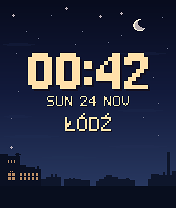
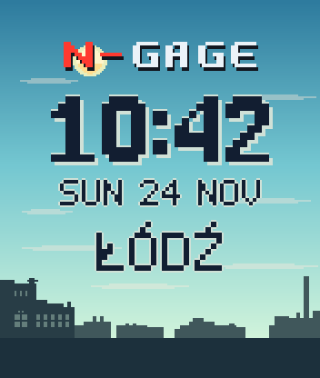
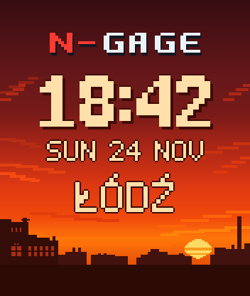
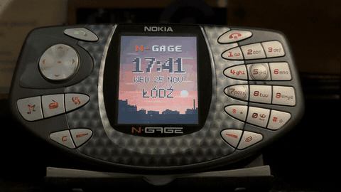
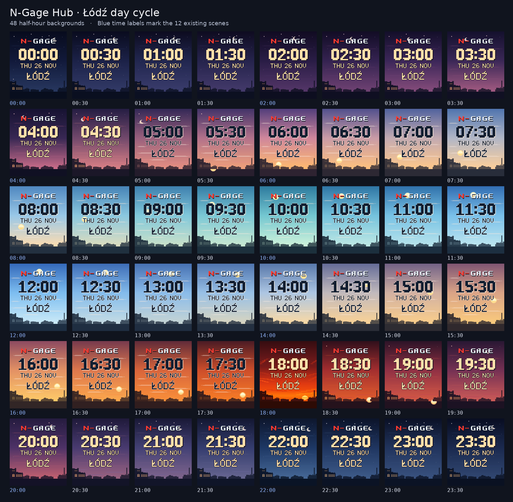

# N-Gage Hub

A **176 × 208** pixel-art clock for the original Nokia N-Gage. It shows the time, date, and city over the Łódź skyline. The background follows the device’s local clock through twelve two-hour scenes, from midnight to late evening.

<p align="center">
  
  
  
</p>

<p align="center">
  
</p>

<details>
<summary>See all 12 backgrounds</summary>



</details>

## Run on the N-Gage Classic

The original Nokia N-Gage (NEM-4) uses Series 60. The included PyS60 1.3.1 installer targets that platform. The launcher passed tests under Python 2.2.2 with simulated phone APIs. Installation and rendering on a physical Classic are still unverified.

1. Copy the PyS60 installer to the root of a writable **MMC**. Use the Classic’s mini-USB data cable if the card appears in Finder, or use an MMC reader. Eject the card and disconnect USB before installing. [PyS60 installer](symbian/PythonForS60_1stEd_1_3_1.SIS) · [Nokia Classic user guide](https://db.hfsplay.fr/files/2019/09/11/nokia-n-gage_O75pEQx.pdf)
2. On the Classic, open **Menu → Tools → Manager**, select the installer, and choose **Options → Install**. Choose **Memory card** if prompted. Check that **Python** opens from the main menu.
3. Copy the clock script into `System/Apps/Python/my/` on the card, creating `my` if needed. Keep it on the same drive as PyS60 so the Python menu can find it. [Clock script](symbian/ngage_hub.py) · [Nokia’s script installation guide](https://mobilenin.com/pys60/resources/pys60_v_1_2/Getting_Started_with_Python.pdf#page=14)
4. Open **Python → Options → Run script → ngage_hub.py**. Press the **right softkey** to return to Python.

On first launch, check that the dashboard fills the screen and the clock matches the phone. Leave it untouched past the usual backlight and screensaver timeouts to check that it stays visible. The script resets the inactivity timer while it runs and stops resetting it when you exit.

The phone script includes a small EKA1 helper for PyS60 1.3.1 and caches it on the Python drive or in phone memory. Transfer only `ngage_hub.py`. If the phone cannot load the helper, the script shows a notice and continues displaying the clock with the phone’s normal timeout.

<details>
<summary>Bluetooth transfer</summary>

Pair the Classic with your Mac and send the SIS using **Bluetooth File Exchange**. Open it in **Messaging → Inbox** on the phone and install it. Send `ngage_hub.py` next, open it in the Inbox, and choose **Python script**. If PyS60 is already installed in phone memory, start with the script transfer. [Apple’s transfer instructions](https://support.apple.com/en-euro/guide/mac-help/mchle7fa9e15/mac) · [Nokia’s Python setup guide](https://mobilenin.com/pys60/resources/pys60_v_1_2/Getting_Started_with_Python.pdf)

</details>

## Run on macOS

From the project directory, use Python 3.11–3.14 to set up the virtual environment once.

```sh
python3 -m venv .venv
.venv/bin/python -m pip install -r requirements.txt
```

Start the preview with live reload.

```sh
.venv/bin/python -B -m desktop.dev
```

The window opens at **176 × 208**. Add `--scale 2` for a larger view, or run `.venv/bin/python -B -m desktop.preview` for a one-off preview. Press **Esc** to quit.

Saving Python files under `hub/` or `desktop/` restarts the preview. If a save introduces an error, the watcher waits for your next edit. Restart the dev command after editing the watcher itself.

## Edit the dashboard

| File | What to edit |
| --- | --- |
| [`hub/dashboard.py`](hub/dashboard.py) | Time, date, and city layout |
| [`hub/day_cycle.py`](hub/day_cycle.py) and [`hub/sunset.py`](hub/sunset.py) | Two-hour sky scenes, skyline, and colors |
| [`hub/pixel_font.py`](hub/pixel_font.py) | Bitmap lettering |
| [`hub/mock_weather.py`](hub/mock_weather.py) | City label and optional development weather samples |
| [`desktop/`](desktop/) | Pygame preview and file watcher |
| [`symbian/`](symbian/) | PyS60 launcher, builder, and transfer files |

The shared renderer uses Python 2.2-compatible syntax and draws through a single `fill_rect` operation. Both launchers pass the current device’s local time to the same renderer.

After editing the dashboard, rebuild the phone script from the project directory.

```sh
python3 symbian/build.py symbian/ngage_hub.py
```

If you change the EKA1 helper in `symbian/awake.s`, rebuild it with GNU Arm binutils before rebuilding the phone script.

```sh
python3 symbian/build_awake.py
python3 symbian/build.py symbian/ngage_hub.py
```
